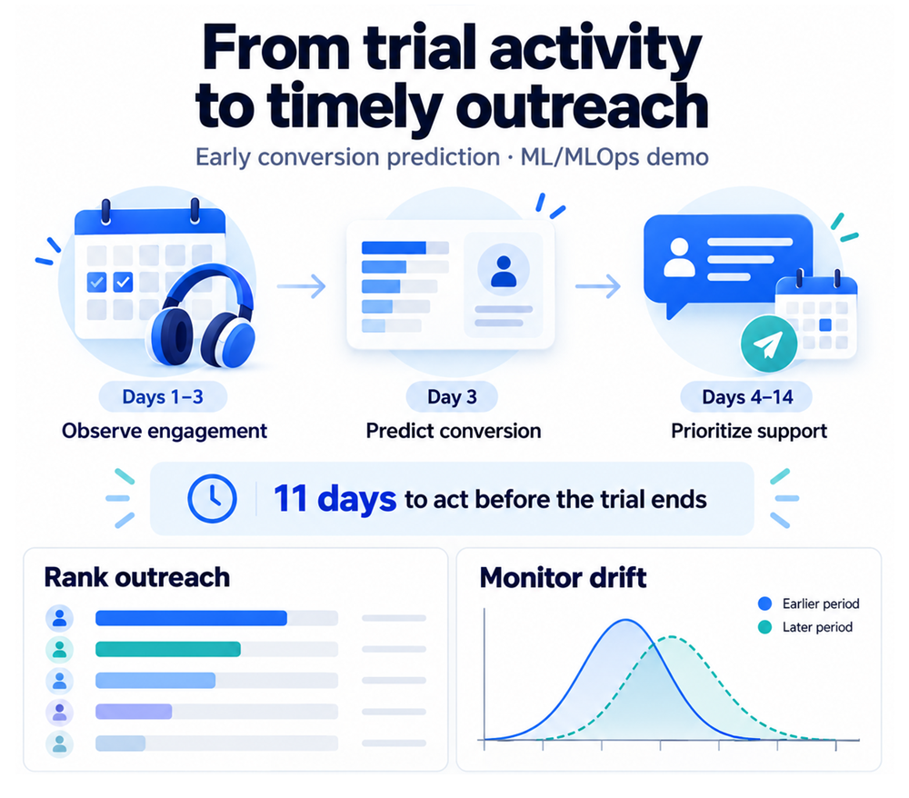
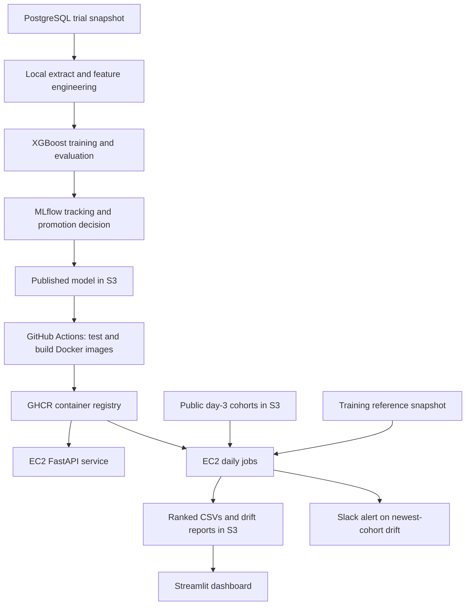
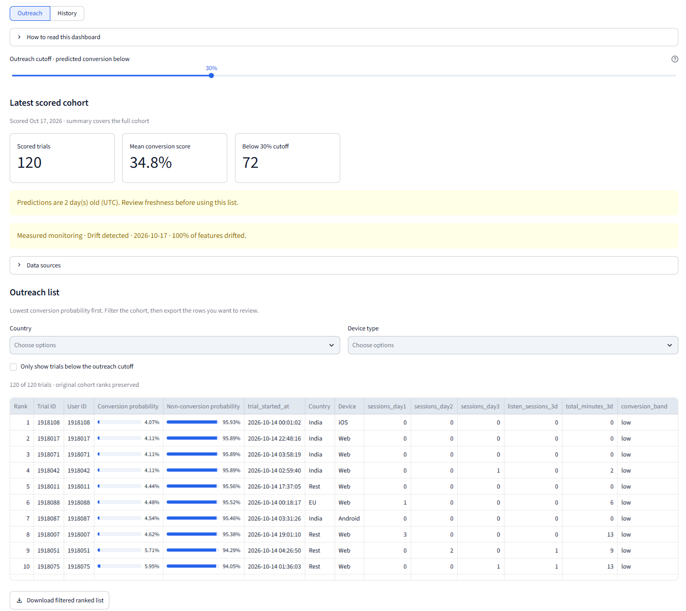
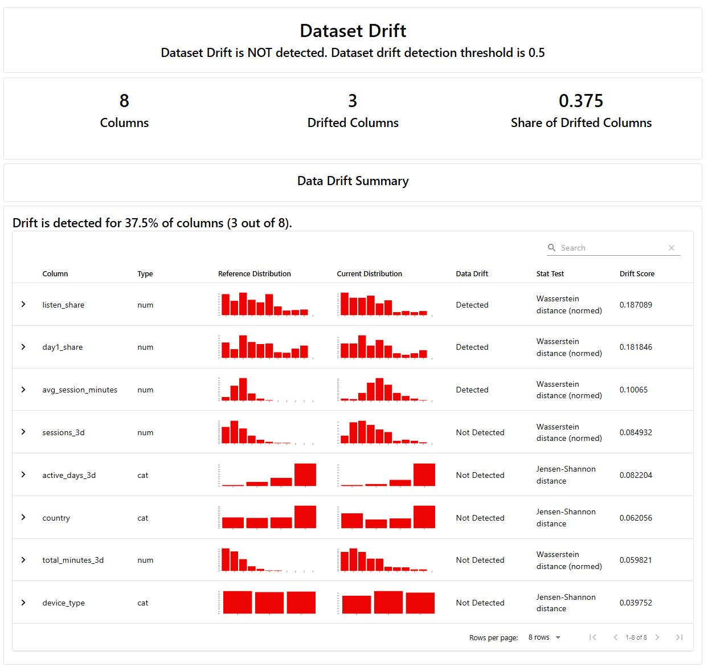

# Trial Conversion Prediction

**An end-to-end machine learning project that turns early trial activity into daily outreach priorities, with an API, automated deployment, and drift monitoring.**

Built by **Husayn El Sharif**. The project models a subscription-based digital content platform using **synthetic user engagement and trial-conversion data**. Users explore the service during a **14-day trial**, then choose whether to become paying subscribers or abandon the service. Scoring after the first three days gives a growth team approximately **11 days to offer support before the trial expires**.

The workflow demonstrates skills that transfer to similar subscription services: feature engineering, model evaluation, experiment tracking, API and batch delivery, automated cloud deployment, and monitoring.



| At a glance | Implementation |
| --- | --- |
| Business output | A daily list of trials ranked from least to most likely to convert |
| Model | XGBoost classifier; recorded test ROC-AUC **0.8831** |
| Experiment management | MLflow tracking, model registry, and conditional champion promotion |
| Delivery | FastAPI for individual predictions; batch CSVs in Amazon S3 |
| Deployment | Docker images published to GHCR and deployed to AWS EC2 through GitHub Actions |
| Monitoring | Daily Evidently drift checks, S3 reports, and Slack webhook alerts |
| Dashboard | [Streamlit app](streamlit_app.py) in this repository: ranked trials, latest drift verdict, and monthly history |

The core workflow is implemented. This is a deployed learning and portfolio project; its measured model results and operational capabilities are described below without claiming a demonstrated increase in paid conversions.

## Contents

- [Business problem](#business-problem)
- [Lessons for similar subscription services](#lessons-for-similar-subscription-services)
- [How the system works](#how-the-system-works)
- [Data, features, and model results](#data-features-and-model-results)
- [Training and model promotion](#training-and-model-promotion)
- [Prediction delivery](#prediction-delivery)
- [Daily automation and monitoring](#daily-automation-and-monitoring)
- [Deployment and quality checks](#deployment-and-quality-checks)
- [Run the project locally](#run-the-project-locally)
- [Repository guide](#repository-guide)
- [Limitations and next steps](#limitations-and-next-steps)

## Business problem

The business setting is a digital content service where users engage through sessions, including listening sessions. During a 14-day trial, some users return regularly and spend more time exploring content, while others use the service briefly or stop returning. The synthetic data captures those engagement patterns and the eventual paid-conversion outcome.

Growth teams have limited capacity to contact trial users. A ranked list helps them prioritize users who appear unlikely to convert while there is still time for onboarding support or engagement prompts. By scoring at the end of day 3, the system supports outreach during days 4–14, before users decide whether to pay for continued access or leave.

For each new trial user, the model receives session counts for days 1, 2, and 3; listening-session counts and total engagement minutes across those days; country; and device type. Those inputs become features describing activity volume, consistency, and depth. The eventual conversion outcome is a training label, not a prediction input.

The prediction target is `converted`: **1** means the trial became a paid subscription and **0** means it did not. The system scores at day 3 using activity available at that point. Lower predicted conversion probability means higher priority in the outreach list.

A prediction estimates conversion likelihood; it does not estimate whether an intervention will work. Establishing business impact would require a controlled outreach experiment.

## Lessons for similar subscription services

This project demonstrates an adaptable workflow for digital content, SaaS, and membership services that offer trials:

- **Make predictions actionable:** choose an observation window early enough to leave time for onboarding or engagement support.
- **Keep features consistent:** reuse transformations across training, API predictions, batch scoring, and monitoring to reduce discrepancies.
- **Separate model selection from delivery:** track experiments and promotion decisions, then package and deploy the selected model through a repeatable pipeline.
- **Put operational context next to predictions:** show data freshness and drift alongside outreach rankings so teams can judge whether outputs need investigation.
- **Validate business value separately:** adapt features, trial windows, and outreach capacity to the service, evaluate on later cohorts, and test whether outreach produces incremental conversions.

The recorded evaluation demonstrates performance on this synthetic dataset. Applying the workflow to another service requires evaluation and calibration on that service's data; the reported AUC is not a forecast of results elsewhere.

## How the system works



Training, serving, and monitoring have separate responsibilities. Training publishes model artifacts; the API and scoring job load a model packaged in their images. Drift checks compare incoming features with the training reference and do not require model predictions. Cron schedules the jobs; the dashboard reads their saved outputs.

The diagram shows the conditional promotion path. The original training command remains available and publishes artifacts unconditionally.

## Data, features, and model results

### Data and features

The engagement and conversion records are synthetic. Training starts from a local CSV extract of PostgreSQL view `ml.trial_snapshot_latest`. Keeping the extract fixed allows experiments to use the same input data. Scheduled jobs download dated day-3 cohorts from the public `fpds-trial-cohorts` S3 bucket.

Raw prediction inputs are `sessions_day1`, `sessions_day2`, `sessions_day3`, `listen_sessions_3d`, `total_minutes_3d`, `country`, and `device_type`. The shared feature function derives the following inputs using only the first three days:

| Feature group | Model inputs | What they describe |
| --- | --- | --- |
| Activity volume | `sessions_3d`, `total_minutes_3d` | How much the user engaged |
| Activity consistency | `active_days_3d`, `day1_share` | Whether engagement continued beyond day 1 |
| Activity mix and depth | `listen_share`, `avg_session_minutes` | How the user engaged |
| Context | `country`, `device_type` | Geographic and device categories |

Country and device type are one-hot encoded for training. Zero-session trials receive zero-valued shares and average duration, preserving inactivity as information. The same feature function is reused for training, prediction, and drift monitoring.

### Recorded evaluation

The local `models/metrics.json` inspected on **October 17, 2026** records the following promoted candidate. This is a saved evaluation result, not a new training run or a live production metric; the model and metrics files are generated artifacts excluded from Git.

| Measure | Recorded value |
| --- | --- |
| Training examples | 1,137 |
| Held-out test examples | 379 |
| Candidate test ROC-AUC | **0.8831** |
| Previous recorded ROC-AUC | 0.8750 |
| Absolute improvement | 0.0081 |
| Required improvement for promotion | 0.0050 |
| Promotion result | Promoted; registered model version 2 |

ROC-AUC measures how well the model ranks converters above non-converters across decision thresholds. It is not an accuracy percentage or proof of calibrated probabilities.

Training uses a stratified **75% / 25% split**, `random_state=42`, and XGBoost with 500 trees, maximum depth 3, and learning rate 0.01. These results come from a random holdout; evaluation on later cohorts remains a next step.

## Training and model promotion

MLflow records model parameters, split settings, dataset metadata, a timestamp-based data version, and held-out ROC-AUC. The conditional workflow compares a candidate against the higher available incumbent AUC from local artifacts and the MLflow registry.

- **Promote:** an absolute AUC improvement of at least `0.005`; publish model and metrics, register the candidate, and assign the `champion` alias.
- **Reject:** retain existing artifacts and the registry alias while logging the experiment and decision.
- **First model:** promote when neither source contains an incumbent. Invalid incumbent metadata or registry failures stop the workflow.

| Entry point | Purpose |
| --- | --- |
| `scripts/build.py` | Build the encoded training table from the raw extract |
| `scripts/train_and_register.py` | Train and apply the promotion rule |
| `scripts/train.py` | Train and overwrite local/S3 artifacts unconditionally |
| `scripts/build_and_train.py` | Combine feature building with unconditional training |

Promotion publishes to the existing S3 model keys. It does not itself rebuild containers or restart EC2; the deployment workflow handles image delivery. See the [training reference](docs/operations.md#train) for registry fallback, artifact contents, and partial-failure behavior.

## Prediction delivery

### On-demand API

The FastAPI service loads `models/model.json` at startup and returns a conversion probability and band for one trial.

| Endpoint | Purpose |
| --- | --- |
| `POST /predict` | Validate activity inputs, score a trial, and log the prediction |
| `GET /health` | Return service status and installed package version |
| `GET /docs` | Interactive API documentation |
| `GET /prediction-logs` | View recorded predictions in a browser |

Example request body:

```json
{
  "sessions_day1": 3,
  "sessions_day2": 2,
  "sessions_day3": 2,
  "listen_sessions_3d": 5,
  "total_minutes_3d": 180,
  "country": "US",
  "device_type": "iOS"
}
```

Illustrative response; the actual probability depends on the loaded model:

```json
{"conv_prob": 0.8593, "conv_band": "high"}
```

Bands are **low** below `0.33`, **medium** from `0.33` to below `0.66`, and **high** from `0.66`. Missing required fields are rejected with HTTP 422. Successful predictions append request fields and scores to `logs/predictions.jsonl`.

### Daily ranked list and dashboard

The batch job produces `predictions/scored_YYYY-MM-DD.csv` in S3, sorted by ascending `conversion_probability`. It includes the original cohort fields, probability, and conversion band.

The [Streamlit dashboard](streamlit_app.py) displays the latest ranking and drift verdict, filters outreach candidates, and shows a 31-day or calendar-month history with CSV downloads. It labels synthetic backfilled drift reports and prefers measured reports on overlapping dates. It reads this repository's `.env` and uses read-only S3 access. Launch instructions are below.



*Dashboard snapshot: lower predicted conversion probabilities appear first. The displayed counts, scores, and warnings describe the captured cohort, not a live feed.*

## Daily automation and monitoring

The EC2 host uses two cron entries with the image `ghcr.io/helsharif/trial-conversion-model-jobs:latest`:

| Schedule | Job | Outputs |
| --- | --- | --- |
| **06:30 daily** | `scripts/score.py` | Ranked trial CSV uploaded to S3 |
| **06:45 daily** | `scripts/check_drift.py` | Oldest/newest cohort comparisons, HTML reports, JSON verdicts, and a Slack webhook request when the newest cohort drifts |

Times follow the **EC2 cron timezone**, not necessarily the reader's local timezone. The two jobs run independently; the 15-minute gap is not a dependency check. The [EC2 runbook](docs/operations.md#daily-scoring-and-drift-checks-on-ec2) retains both exact cron commands, host setup requirements, and log inspection commands.

Evidently compares the eight feature distributions with the training reference. **Dataset drift is flagged when at least 50% of features drift**—four of the current eight. The fraction describes features, not users. Drift is an investigation signal; model performance can only be confirmed once conversion labels arrive.



*Example monitoring snapshot: three of eight features drifted (37.5%), below the 50% dataset-level threshold. This report and the dashboard screenshot show separate snapshots, so their drift verdicts differ. The percentage refers to features, not users.*

| Artifact | Location |
| --- | --- |
| Training reference for drift | `s3://<S3_BUCKET>/data/trial_snapshot.csv` |
| Ranked trials | `s3://<S3_BUCKET>/predictions/scored_YYYY-MM-DD.csv` |
| Detailed drift report | `s3://<S3_BUCKET>/monitoring/<cohort-name>.html` |
| Compact drift verdict | `s3://<S3_BUCKET>/monitoring/<cohort-name>.json` |
| Cron stdout/stderr | `/home/ubuntu/logs/cron.log` on EC2 |

Containers use the instance IAM role for AWS access and `/home/ubuntu/.env` for bucket, region, and Slack settings. A host data mount preserves cohorts, the reference snapshot, and scored CSVs. Drift reports persist in S3. Checks do not automatically retrain or promote a model.

## Deployment and quality checks

The [GitHub Actions workflow](.github/workflows/ci.yml) defines the delivery pipeline:

1. Install locked dependencies and run Ruff.
2. Download the published model from S3 and run pytest.
3. Build both the API and jobs images.
4. On `main`, publish images to GHCR with `latest` and commit-SHA tags.
5. Connect to EC2 over SSH, pull both images, replace the API container, and remove unused dangling images. Cron uses the refreshed jobs image on its next run.

Deployment requires the configured AWS, GHCR, and EC2 GitHub secrets, an accessible EC2 host, and host access to the registry. The workflow definition describes the configured automation; consult its run history for the result of any individual deployment.

Tests cover API health and input validation, prediction response structure, zero-session feature handling, and champion promotion decisions and failures. Promotion tests mock external services. API tests require a local model file because the service loads it at import time.

```bash
uv run ruff check .
uv run pytest
```

## Run the project locally

Use **Python 3.13+** and **uv**. Run commands from the repository root. Private training data and model artifacts are not included in a fresh clone.

### 1. Install and configure

```bash
git clone https://github.com/helsharif/trial-conversion-model.git
cd trial-conversion-model
uv sync --locked
```

Copy `.env.example` to `.env` and supply your own configuration. In PowerShell, use `Copy-Item .env.example .env`.

| Configuration | Needed for |
| --- | --- |
| `DB_HOST`, `DB_PORT`, `DB_NAME`, `DB_USER`, `DB_PASSWORD` | Fetching the authorized training snapshot |
| `MLFLOW_TRACKING_URI` | Training and registry access; local default is `http://127.0.0.1:5001` |
| AWS credentials or an IAM role; `AWS_DEFAULT_REGION` | Reading/writing authorized S3 artifacts |
| `S3_BUCKET` | Batch predictions, drift reports, and reference download |
| `SLACK_WEBHOOK_URL` | Optional newest-cohort drift alert |

Training currently uses `futureproofds-trial-conversion-artifacts-bucket-001` directly, while scoring and monitoring read `S3_BUCKET`. See [configuration details](docs/operations.md#configure-mlflow-and-aws) before adapting this project to another AWS account. Keep secrets out of Git.

### 2. Fetch, build, and train

Start MLflow in a separate terminal:

```bash
uv run mlflow server --host 127.0.0.1 --port 5001 --workers 1
```

Then prepare the data and run conditional training:

```bash
uv run scripts/fetch_data.py
uv run scripts/build.py
uv run scripts/train_and_register.py
```

This path requires database access, a reachable MLflow server, and S3 upload permissions. Fetching replaces the local raw extract. If you already have an authorized extract, place it at `data/01_raw/trial_snapshot.csv` and skip fetching.

### 3. Start the API

With `models/model.json` available from training or an authorized artifact download:

```bash
uv run uvicorn trial_conversion_model.api.main:app --reload
```

Open [interactive API docs](http://127.0.0.1:8000/docs) to submit the example request. Docker commands, batch scoring behavior, and manual drift checks are documented in the [operations reference](docs/operations.md).

### 4. Open the Streamlit dashboard

The dashboard is included in this repository. After `uv sync --locked`, run:

```bash
uv run streamlit run streamlit_app.py
```

Open [the dashboard](http://localhost:8501). If that port is occupied, add
`--server.port 8502` and open [port 8502](http://localhost:8502). Press **Ctrl+C**
in the terminal to stop it.

It reads `S3_BUCKET` and AWS settings from the root `.env`, with environment
variables taking precedence. It also supports AWS profiles and IAM roles. The
AWS identity needs `s3:ListBucket` and `s3:GetObject` access to prediction and
monitoring artifacts. The dashboard does not require a local model, database,
MLflow server, or running API. Streamlit is included in the default development
dependencies installed by `uv sync`.

Use **Refresh from S3** to bypass the five-minute cache. Rankings place the
lowest conversion probabilities first; filters cover country, device, and an
adjustable outreach cutoff. History defaults to 31 days ending at the newest
artifact date, with a calendar-month option. Both views support CSV download.
See [dashboard behavior and validation](docs/operations.md#streamlit-dashboard)
for artifact formats and missing-data handling.

## Repository guide

| Location | Responsibility |
| --- | --- |
| [src/trial_conversion_model/](src/trial_conversion_model/) | Data access, feature engineering, training, prediction, cohort retrieval, and monitoring |
| [src/trial_conversion_model/api/](src/trial_conversion_model/api/) | FastAPI application, routes, and request/response schemas |
| [scripts/](scripts/) | Command-line entry points, including training, daily scoring, drift checks, and synthetic history backfill |
| [tests/](tests/) | Feature, API, model promotion, and dashboard tests |
| [streamlit_app.py](streamlit_app.py) | Dashboard interface, filters, history charts, and CSV downloads |
| [dashboard_data.py](src/trial_conversion_model/dashboard_data.py) | S3 artifact loading, validation, ranking, and report selection |
| [Dockerfile](Dockerfile) / [Dockerfile.jobs](Dockerfile.jobs) | Separate service and scheduled-job images |
| [.github/workflows/ci.yml](.github/workflows/ci.yml) | Test, image publication, and EC2 deployment pipeline |
| [notebooks/](notebooks/) | Exploratory analysis |
| [docs/operations.md](docs/operations.md) | Detailed training semantics, configuration, API examples, and EC2 runbook |

Generated data, models, logs, monitoring reports, and local EC2 setup files are ignored by Git. Re-running jobs for the same cohort replaces the corresponding S3 keys. Backfilled history is synthetic and should not be interpreted as evidence of historical measured performance.

## Limitations and next steps

- **Validate over time:** evaluate later cohorts and probability calibration; the recorded score uses a random holdout.
- **Measure business impact:** test whether outreach informed by the ranking improves conversion, accounting for intervention costs.
- **Strengthen promotion comparisons:** candidates are compared with saved incumbent AUC values, not re-evaluated alongside the incumbent on an enforced common test set. Data versions are timestamps rather than content hashes.
- **Harden delivery:** local files, S3, and the MLflow registry do not update atomically. Add rollback and artifact consistency checks around promotion and deployment.
- **Harden operations:** add job failure alerts, overlap prevention, log rotation, and post-deployment health verification. Input drift alerts alone do not cover these failure modes.
- **Protect and persist serving data:** API routes currently have no authentication. The deployed API command has no log volume, so replacing its container loses local prediction logs.

For exact commands and behavior, see the [training and operations reference](docs/operations.md).
